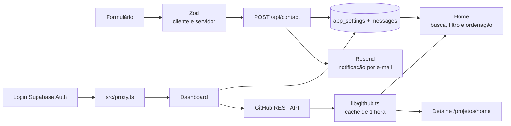

# Guia de gravação — entrevista técnica do portfólio

Roteiro pensado para uma fala natural de **7min30s a 7min50s**, sem passar do limite de oito minutos. Não precisa decorar: entenda os pontos, ensaie uma vez e fale com suas palavras.

## Antes de gravar

- Grave a tela inteira com a câmera ligada e o rosto visível durante todo o vídeo. Posicione a câmera como uma pequena janela sobre a tela, sem cobrir o código que vai mostrar.
- Feche notificações e abas pessoais. Não mostre `.env.local`, chaves, inbox pessoal, senhas ou tokens. Se precisar mostrar variáveis, use só `.env.example`.
- Aumente o zoom do editor e do navegador para que código e textos fiquem legíveis. Deixe as abas necessárias abertas antes de começar.
- Teste microfone, câmera, compartilhamento e resolução. Faça uma gravação de 15 segundos e confira o áudio e se rosto/tela aparecem juntos.
- Na parte visual, use o site local ou publicado. Para demonstrar o mobile, use a emulação de celular do navegador.
- **Preencha antes de gravar:** confira no seletor/histórico do Copilot qual modelo realmente estava selecionado e complete o campo `[modelo confirmado]`. Não adivinhe o modelo.
- O Supabase, Resend, GitHub remoto e Vercel ainda precisam ser conectados/configurados. Até isso ser feito, apresente-os como arquitetura e preparação de deploy, não como serviços já funcionando em produção.

## Mapa rápido do que mostrar

| Tempo     | Na tela                                                                 | Objetivo                                            |
| --------- | ----------------------------------------------------------------------- | --------------------------------------------------- |
| 0:00–0:25 | Home do portfólio, câmera visível                                       | Apresentar você e a ideia do site                   |
| 0:25–1:30 | Site e árvore de `src/`                                                 | Explicar arquitetura e fluxo de dados               |
| 1:30–2:45 | Busca de projetos, detalhe, tema e formulário                           | Demonstrar a experiência pública                   |
| 2:45–3:45 | Login e dashboard                                                       | Mostrar métricas reais e salvar destaques           |
| 3:45–4:30 | `README.md` e schema SQL                                                | Comparar escolhas e trade-offs                      |
| 4:30–6:15 | `.github/copilot-instructions.md`, scripts e testes                     | Explicar o harness de IA com evidências             |
| 6:15–7:15 | `.github/workflows/ci.yml`, `.husky/pre-commit` e Vercel (se configurada) | Explicar qualidade, branches e caminho até deploy |
| 7:15–7:40 | Voltar à home                                                           | Resumir e encerrar                                  |

## Diagrama para deixar pronto numa aba ou slide

Use este desenho simples no vídeo. Pode colá-lo num editor Mermaid ou recriá-lo com caixas e setas:

O envio a Resend e a persistência só ficam ativos depois que as credenciais forem configuradas. Se ainda não tiver configurado, diga isso ao apontar o fluxo.

## Roteiro falado com demonstração

### 0:00–0:25 — Apresentação

**Mostre:** a home no navegador; deixe a câmera pequena, mas nítida.

**Diga:**

> “Oi, eu sou a Lívia Pisanello, desenvolvedora full stack e estudante de Engenharia de Software. Neste projeto eu quis apresentar meus projetos e também mostrar como pensei a arquitetura, a experiência de uso e o processo de desenvolvimento com apoio de IA. Vou começar pelo site e depois mostrar como as partes se conectam.”

### 0:25–1:30 — Site, arquitetura e fluxo

**Mostre:** role pela home; abra no editor `src/app/page.tsx`, `src/components/project-explorer.tsx`, `src/lib/github.ts` e a árvore de pastas. Em seguida, mostre o diagrama preparado.

**Diga:**

> “A aplicação usa React com Next.js App Router e TypeScript. Separei as rotas em `src/app`, a interface reutilizável em `src/components` e integrações e regras em `src/lib`. Por exemplo, a home pede os repositórios ao serviço do GitHub; a área de projetos permite buscar por nome, descrição ou tecnologia, filtrar por linguagem e ordenar. Cada card leva a `/projetos/nome`, uma rota que pode ser aberta diretamente ou atualizada no navegador.”
>
> “No contato, o mesmo schema Zod é usado no navegador e no endpoint, para a validação não depender só da interface. O endpoint salva a mensagem no Supabase e tenta enviar um e-mail pelo Resend. No painel, o Supabase Auth identifica a pessoa, o proxy protege a rota e as políticas RLS restringem a leitura e as alterações.”

**Aponte no diagrama:** GitHub → serviço/cache → home/detalhes; formulário → Zod → endpoint → banco/e-mail; login → proxy → painel.

### 1:30–2:45 — Demonstração funcional

**Mostre, nesta ordem:**

1. Em projetos, clique em **Explorar todos os repositórios**.
2. Busque por uma palavra ou tecnologia; escolha uma linguagem e altere a ordenação.
3. Abra um card para demonstrar a rota individual.
4. Volte à home, alterne tema e mostre que a preferência se mantém após atualizar.
5. No formulário, envie vazio para mostrar os erros por campo.
6. Opcional: abra uma URL inexistente e mostre a página 404.

**Diga:**

> “A lista vem dos repositórios públicos, não de cards cadastrados manualmente. Quando a API está disponível, também vejo descrição, linguagem e data de atualização. A busca e os filtros são locais depois que a lista é carregada. A preferência de tema fica no navegador. O formulário dá um erro específico para cada campo e bloqueia um segundo envio enquanto está processando.”
>
> “Neste ambiente [diga uma das opções: ‘o serviço ainda não está configurado e o site informa isso’ / ‘fiz um envio de teste e vou mostrar a confirmação’]. Preferi exibir essa limitação a apresentar uma confirmação falsa.”

### 2:45–3:45 — Dashboard e administração

**Prepare antes:** confirme o acesso ao Supabase e entre no dashboard antes de gravar. Deixe a página pública aberta numa segunda aba. Não grave credenciais, tokens, endereços de e-mail ou conteúdo privado de mensagens. Se não houver mensagens seguras para mostrar, demonstre os contadores zerados e a seleção de projetos.

**Mostre, nesta ordem:**

1. O resumo do painel: projetos em destaque, repositórios públicos, mensagens recebidas e mensagens em aberto. São contagens calculadas a partir dos dados carregados, não números ilustrativos.
2. Na seção de projetos, desmarque um repositório e selecione outro.
3. Clique em **Salvar seleção** e mostre a confirmação.
4. Abra **Conferir na página inicial**. Atualize a home se necessário e confirme que os cards em destaque refletem a seleção salva.
5. Se tiver mensagens reais e puder mostrá-las com segurança, marque uma como respondida e explique que a contagem “Em aberto” acompanha o estado.

**Diga:**

> “O dashboard é protegido pelo login do Supabase e pelas políticas RLS. Aqui eu acompanho quatro números que vêm do estado atual: quantos projetos estão na vitrine, quantos repositórios públicos foram encontrados, quantas mensagens chegaram e quantas ainda precisam de resposta. Posso trocar os destaques, salvar a configuração e conferir a mudança na home. A leitura da preferência é feita sem cache para a seleção aparecer na próxima visita à página.”

> “As contagens são úteis para dar contexto rápido, mas não são analytics de acesso: o site não rastreia visitantes nem inventa métricas de tráfego.”

**Se o Supabase ou o login não estiverem configurados:** não tente encenar uma gravação bem-sucedida. Mostre a tela de configuração/acesso restrito, explique a implementação no código e diga que a demonstração ao vivo depende de conectar o serviço. Não afirme que os dados persistem se você não verificou.

### 3:45–4:30 — Decisões de stack e concessões

**Mostre:** a tabela “Decisões e concessões” do `README.md`; depois o `database/schema.sql`.

**Diga:**

> “Comparei Next.js com uma SPA em Vite e React Router. Escolhi Next.js porque precisava de rotas diretas e de um endpoint no mesmo projeto, conveniente para publicar como uma aplicação. Em troca, sigo as convenções do framework. Para o painel e o banco, comparei Supabase com Firebase ou um backend próprio; Supabase reúne autenticação, Postgres e RLS sem eu operar um servidor. A concessão é depender de configuração e disponibilidade externas.”
>
> “Para os projetos, a API REST do GitHub evita duplicar cadastro e o cache de uma hora reduz chamadas repetidas, embora ainda exista limite da API. Para o estilo, usei CSS próprio e fontes do sistema: consigo controlar a identidade e evito fontes externas, mas sou responsável por manter os estilos e validar o contraste.”

**Dica:** escolha só dois ou três trade-offs que você consegue explicar com tranquilidade. Não leia a tabela inteira.

### 4:30–6:15 — Harness de IA

**Mostre:** `.github/copilot-instructions.md`, depois o seletor do modelo no Copilot e os scripts de `package.json`. Não exponha uma conversa que contenha credenciais.

**Diga:**

> “Usei Copilot no VS Code, com o modelo **[modelo confirmado no seletor]**. Escolhi essa ferramenta por estar integrada ao fluxo de edição e permitir que eu trabalhe no contexto do projeto. A instrução versionada em `.github/copilot-instructions.md` orienta o idioma, a arquitetura, o uso de TypeScript, o tratamento de erros, os segredos, os testes, as branches e os commits.”
>
> “Também deixei claro para a IA não inventar dados pessoais ou resultados, priorizar os dados do GitHub e não esconder erros de integração. Depois de gerar ou alterar código, confiro os arquivos, rodo testes, lint, typecheck e build. Por exemplo, os testes cobrem a validação dos campos, o redirecionamento de visitante sem sessão e os filtros da lista de projetos.”
>
> “Neste repositório não configurei agentes customizados, skills adicionais ou servidores MCP; estou mostrando o que realmente está versionado. O arquivo de instruções é uma orientação, não uma garantia: lint, testes e revisão humana é que verificam o resultado.”

**Se perguntarem sobre o processo:** dê um exemplo verdadeiro de uma alteração, o que você pediu à IA, o que conferiu e qual ajuste fez. Não apresente um prompt hipotético como se fosse um registro real.

### 6:15–7:15 — Branches, qualidade e deploy

**Mostre:** `.github/workflows/ci.yml`, `.husky/pre-commit`, e `package.json`. Se houver Vercel já conectada, mostre o projeto/deploy sem abrir variáveis. Se ainda não houver, fique no código de CI e diga que está preparado, mas pendente de conexão.

**Diga:**

> “Defini GitHub Flow: cada funcionalidade deve começar numa branch como `feature/busca-de-projetos`, entrar na principal por pull request e usar commits Conventional Commits, por exemplo `feat: adiciona filtros de projetos`. O hook do Husky roda Prettier e ESLint nos arquivos staged. A workflow do GitHub Actions verifica lint, formatação, testes, tipos e build em push ou pull request para `main`.”
>
> “O app está preparado para Vercel, mas [se ainda não publicou: ‘ainda falta conectar o repositório, cadastrar as variáveis de ambiente e confirmar o deploy automático’ / se já publicou: explique e mostre o deploy real]. Não vou afirmar que o deploy automático está ativo antes de verificar isso no projeto.”

### 7:15–7:40 — Fechamento

**Mostre:** a home novamente.

**Diga:**

> “Esse projeto reúne meu portfólio, uma integração real com o GitHub e um caminho documentado para contato e administração. O próximo passo é concluir [cite apenas o que ainda estiver pendente: configuração dos serviços, deploy ou medição Lighthouse]. Obrigada.”

## Checklist de última hora

- [ ] Duração ensaiada abaixo de 8 minutos.
- [ ] Rosto e tela aparecem durante todo o vídeo.
- [ ] Modelo de IA confirmado no seletor; nenhum nome foi chutado.
- [ ] Demonstração mostra só funções existentes e integrações cujo estado foi confirmado.
- [ ] `.env.local`, chaves, tokens, senhas e dados privados não aparecem.
- [ ] Branch, CI e deploy são descritos como ativos apenas se foram verificados.
- [ ] Vídeo enviado ao YouTube como **não listado**; link testado numa janela anônima.
